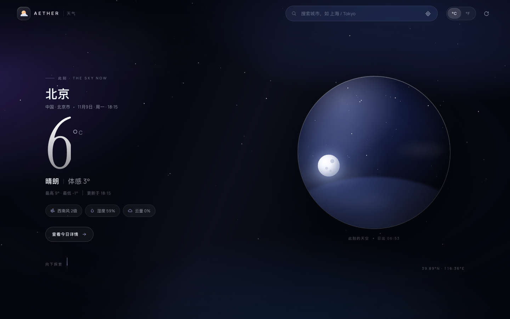
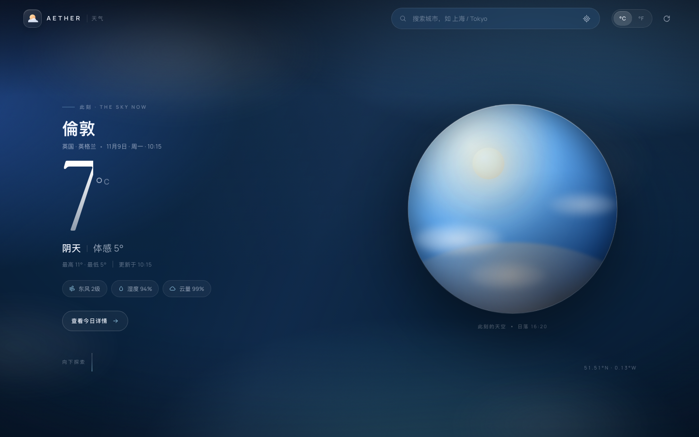
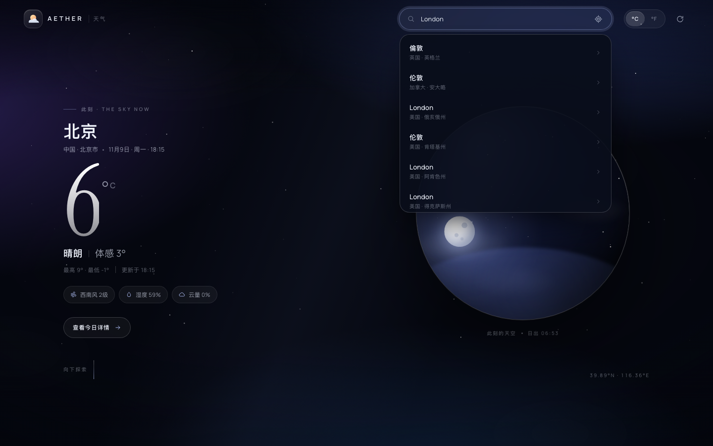
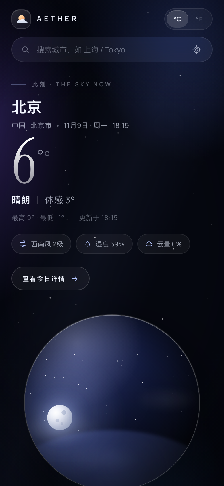

# AETHER · 天气

一个精美的天气预报单页网站：实时天气、未来 24 小时与七天预报、日出日落轨迹、空气质量，以及一颗会随真实天气和时间变化的小小天空。



## 特性

- **实时天气**：接入 [Open-Meteo](https://open-meteo.com/)，无需 API Key，全部在浏览器端请求。
- **会呼吸的天空**：黑夜有星空与月亮，白天有阳光与云层；晴、阴、雨、雪、雾、雷暴各自拥有不同的背景与粒子效果。主题由当地日出日落时间自动判断。
- **一颗微型天空**：首页的玻璃球里，太阳/月亮按真实时间沿弧线移动，云量决定云的浓淡，雨雪天会落下雨丝与雪花。
- **完整体验**：城市搜索（中英文）、浏览器定位、°C/°F 切换、偏好记忆、10 分钟自动刷新。
- **预报细节**：24 小时逐时预报、7 天温度区间、体感温度、湿度与露点、风向风速、气压、能见度、紫外线、空气质量、日出日落与白昼时长。
- **细节与可访问性**：响应式布局、键盘可操作的搜索联想、`prefers-reduced-motion` 支持、语义化标签与屏幕阅读器标签。
- **断网也不空白**：网络或天气服务不可用时自动切换到示例数据，并在底部提示。

## 本地运行

项目零依赖、无构建步骤，直接用任意静态服务器打开即可：

```bash
python3 -m http.server 8000
# 然后访问 http://localhost:8000
```

> 建议通过 HTTP 访问而不是双击 `index.html`，以获得更稳定的字体、定位和缓存行为。

## 数据来源

- 天气预报、逐小时/每日数据：[Open-Meteo Forecast API](https://open-meteo.com/en/docs)
- 空气质量：[Open-Meteo Air Quality API](https://open-meteo.com/en/docs/air-quality-api)
- 城市搜索：[Open-Meteo Geocoding API](https://open-meteo.com/en/docs/geocoding-api)

Open-Meteo 免费供非商业使用；页脚已保留来源链接。所有请求都在浏览器端完成，不经过任何自建服务器。

## 文件结构

```
index.html          页面结构与图标 sprite
styles.css          主题、布局、玻璃质感与动效
app.js              数据获取、状态管理、搜索、渲染、粒子画布
docs/screenshots/   桌面 / 移动 / 不同天气主题的视觉记录
```

## 视觉记录

| 桌面 · 晴夜（北京） | 桌面 · 阴天白昼（伦敦） |
| --- | --- |
|  |  |

| 搜索联想 | 移动端 |
| --- | --- |
|  |  |

完整页面截图见 [`docs/screenshots`](docs/screenshots)。
